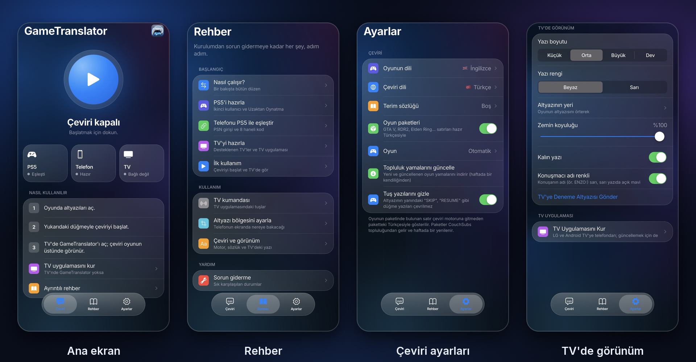
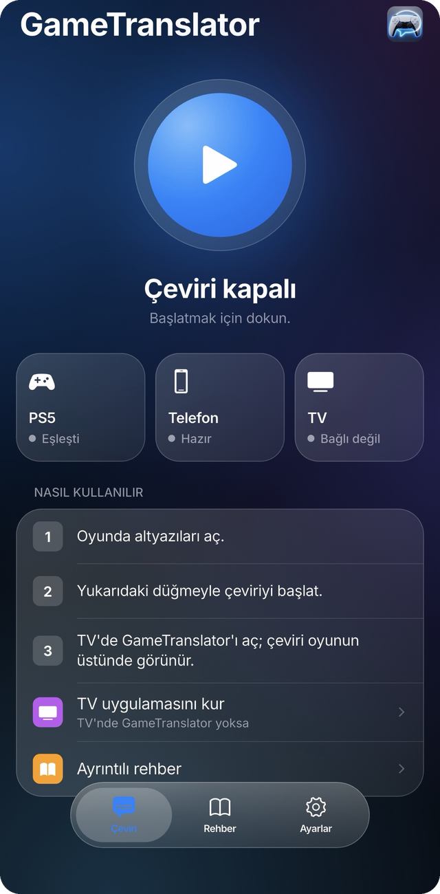
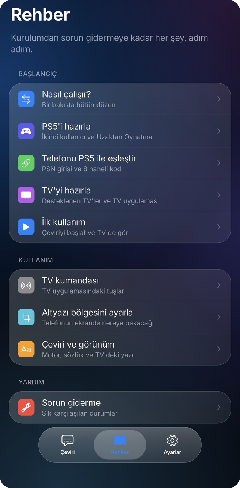
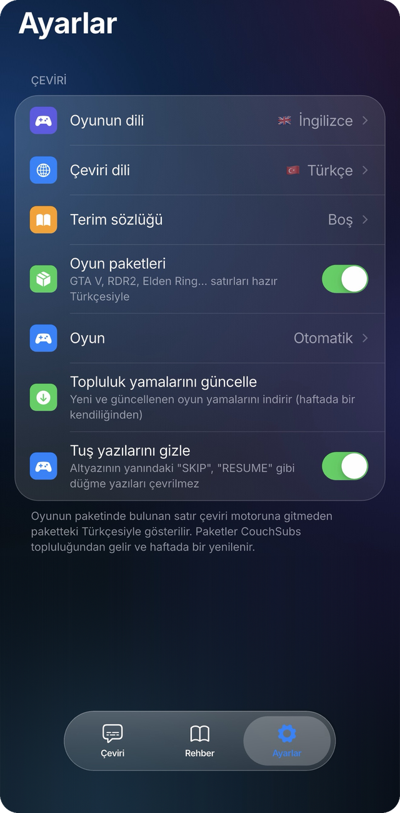
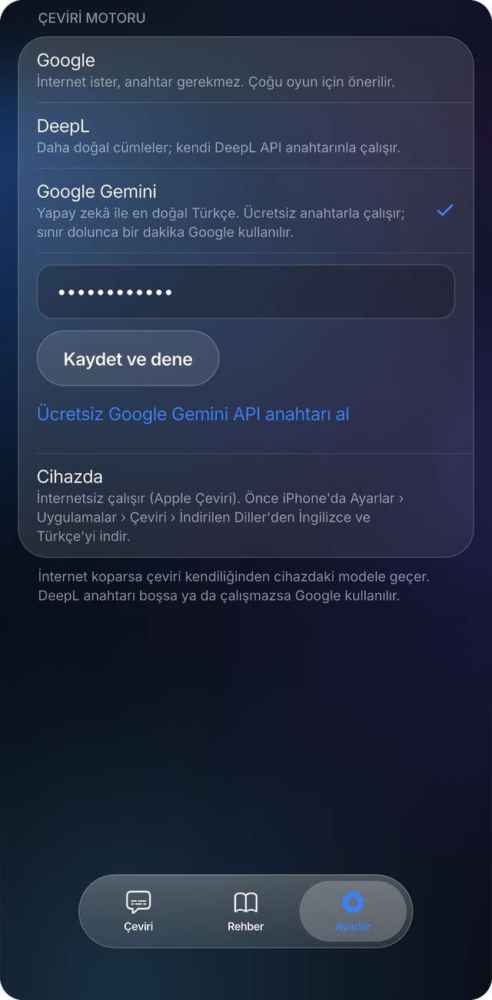
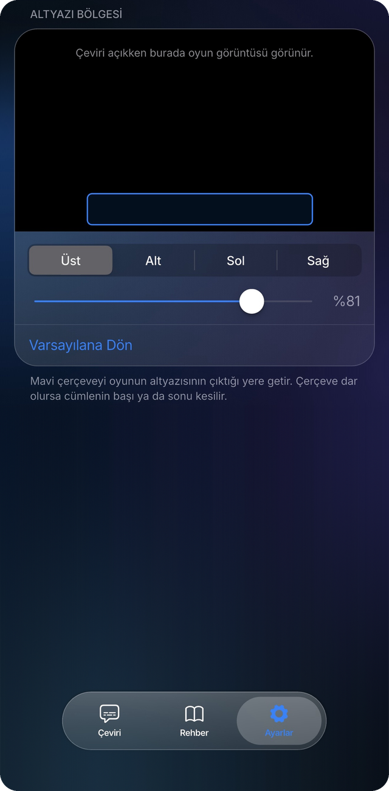
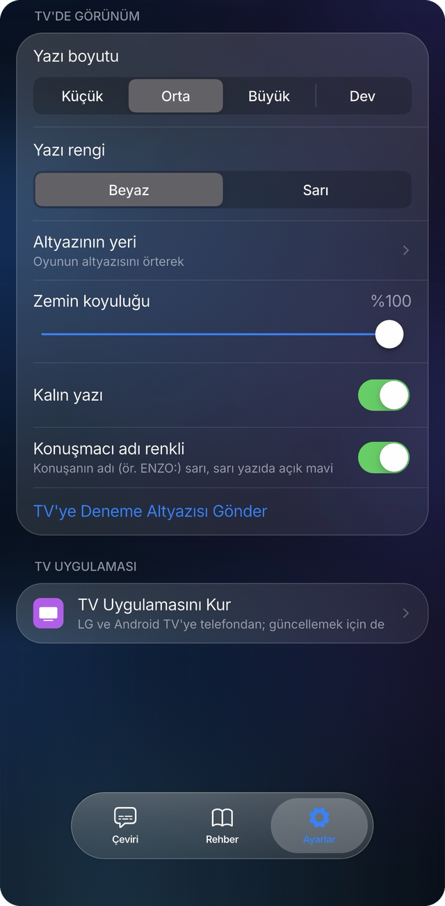
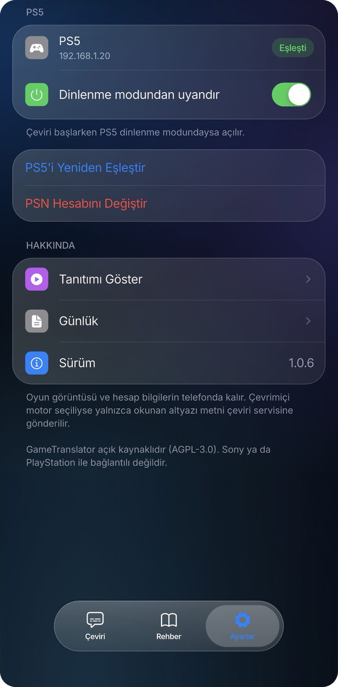

# GameTranslator iOS

> **Bu depo GameTranslator'ın yalnızca iOS (iPhone) derlemelerini içerir; resmî değildir.**
> Asıl proje (Windows, Mac, TV, Android ve tüm belgeler): **[gitlab.com/sefflex/GameTranslator](https://gitlab.com/sefflex/GameTranslator)**
> (Asıl projenin README'si bu depodaki `main` dalında da durur.)

  

PS5 oyunlarının altyazısını iPhone'da okuyup Türkçeye çevirir ve TV'deki GameTranslator uygulamasına gönderir. Telefon
PS5'e Remote Play ile ikinci bir hesapla bağlanır; oyunun görüntüsü ve sesi HDMI ile TV'de kalır, TV'ye yalnızca çeviri gider.

## İndirme ve kurulum

Uygulama App Store'da değildir; imzasız IPA olarak dağıtılır ve kendi sertifikanla imzalanır.

**Feather ile (önerilen, güncellemeler otomatik görünür):**

1. [Feather](https://github.com/khcrysalis/Feather)'ı aç, **Kaynaklar (Sources)** sekmesinde **+** düğmesine bas.
2. Şu adresi yapıştır:
   `https://raw.githubusercontent.com/SimonPetrus/GameTranslator-iOS/feather-source/source.json`
3. Kaynaktan **GameTranslator**'ı seç, indir, imzala ve kur.

**Doğrudan IPA ile:** [Releases](https://github.com/SimonPetrus/GameTranslator-iOS/releases) sayfasından
`GameTranslator-iOS-<sürüm>.ipa` dosyasını indirip Feather, Sideloadly veya AltStore ile imzala ve kur.
Ayrıntılı notlar: [docs/ios-kurulum.md](docs/ios-kurulum.md).

## Gereksinimler

- iPhone (iOS 15 ve üstü; internetsiz (cihazda) çeviri için iOS 26 gerekir).
- PS5, telefon ve TV aynı Wi-Fi ağında.
- TV'de GameTranslator TV uygulaması: [docs/tv-kurulum.md](docs/tv-kurulum.md).
- PS5'te şifresiz bir ikinci kullanıcı ve onun PSN hesabı.

## İlk kullanım

1. Uygulamayı aç, **Yerel Ağ** iznine **İzin Ver** de (yoksa PS5 ve TV bulunamaz).
2. PSN ile ikinci kullanıcının hesabıyla giriş yap.
3. PS5'te Ayarlar › Sistem › Uzaktan Oynatma › Cihaz Eşleştir'i aç; telefonda PS5'i seçip ekrandaki 8 haneli kodu gir.
4. TV'de GameTranslator'ı aç, telefonda büyük düğmeye bas. Ekran kilitlenebilir, çeviri sürer.

TV'den ses gelmezse PS5'te PS tuşu › Ses › Çıkış Cihazı'ndan HDMI'ı seç. Ayarlar ve bilinen sınırlar:
[docs/ios-kurulum.md](docs/ios-kurulum.md).

## Ekran görüntüleri

  
  
  
  
  
  
  

- **Ana ekran**: `01-ana-ekran.png`
- **Rehber**: `02-rehber.png`
- **Çeviri ayarları**: `03-ayarlar-ceviri.png`
- **Motor ayarları**: `04-ayarlar-motor.png`
- **Altyazı ayarları**: `05-ayarlar-altyazi.png`
- **TV ayarları**: `06-ayarlar-tv.png`
- **PS5 ayarları**: `07-ayarlar-ps5.png`

## Lisans ve telif

AGPL-3.0 ([LICENSE](LICENSE)). Bu sürüm, asıl projenin **değiştirilmiş** bir kopyasıdır; tam kaynak kodu bu depodadır
(`mobile/`, `mobile/ios/`). Atıflar: **CouchSubs** (Sinan Yorulmaz), **GameTranslator** (Sefflex) ve **chiaki-ng**;
ayrıntı için [NOTICE](NOTICE) ve [THIRD-PARTY-NOTICES.md](THIRD-PARTY-NOTICES.md).
